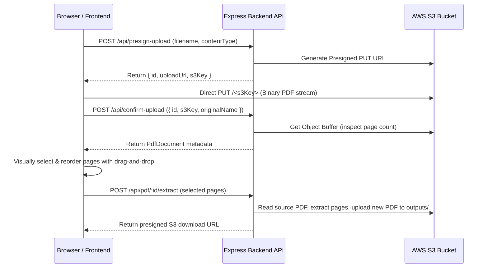

# PDFShift — PDF Page Extractor & Reorder Tool

A modern, responsive web application built with **Next.js 16** (React 19, Tailwind CSS, `@dnd-kit`, `react-pdf`) and an **Express.js TypeScript Backend** structured with **Clean Architecture** and direct **AWS S3 Presigned Uploads**.

**PDFShift** allows users to upload a PDF file directly to S3 via presigned URLs, visually inspect all pages, select specific pages, shift and reorder them via drag-and-drop, and extract them into a brand-new PDF file in seconds.

---

## 🏗️ Architecture

### Backend: Clean Architecture Layers

```
backend/src/
├── domain/                  # ① Enterprise Business Rules
│   ├── entities/            # Pure entity models (PdfDocument.ts)
│   ├── repositories/        # Repository interfaces (IPdfRepository.ts)
│   └── services/            # Storage service interface (IStorageService.ts)
├── application/             # ② Application Business Rules (Use Cases)
│   └── use-cases/           # CreatePresignedUploadUseCase, ConfirmUploadUseCase,
│                            # GetPdfInfoUseCase, ExtractPagesUseCase
├── infrastructure/          # ③ Frameworks & Drivers (Adapters)
│   ├── repositories/        # In-memory implementation (FilePdfRepository.ts)
│   ├── pdf/                 # pdf-lib service adapter (PdfLibService.ts)
│   └── storage/             # AWS S3 adapter with presigning (S3StorageService.ts)
├── presentation/            # ④ Interface Adapters (HTTP Delivery)
│   ├── controllers/         # Express controller (PdfController.ts)
│   ├── routes/              # Express routes (pdf.routes.ts)
│   └── middlewares/         # Centralized error handler (errorHandler.ts)
├── container.ts             # Dependency injection container
└── index.ts                 # Server entry point
```

> **The Dependency Rule:** Inner layers (`domain`, `application`) have zero dependencies on outer frameworks or cloud SDKs (Express, AWS SDK, `pdf-lib`). Adapters implement interfaces declared in the core.

### ⚡ Presigned S3 Upload Workflow



---

## 🚀 Getting Started

### Prerequisites
- Node.js (v18+ recommended, v20 or v22)
- npm
- AWS S3 Bucket (or MinIO / LocalStack)

### 1. Configure Backend Environment

Copy the example environment file and configure your S3 credentials:

```bash
cd backend
cp .env.example .env
```

Edit `backend/.env`:
```env
PORT=4000
AWS_REGION=us-east-1
AWS_S3_BUCKET=your-bucket-name
AWS_ACCESS_KEY_ID=your-access-key-id
AWS_SECRET_ACCESS_KEY=your-secret-access-key
```

#### S3 Bucket CORS Configuration
Make sure your S3 bucket CORS policy allows `PUT` and `GET` requests from your frontend:
```json
[
  {
    "AllowedHeaders": ["*"],
    "AllowedMethods": ["GET", "PUT", "POST", "HEAD"],
    "AllowedOrigins": ["http://localhost:3000"],
    "ExposeHeaders": ["ETag"]
  }
]
```

### 2. Start the Backend Server

```bash
cd backend
npm install
npm run dev       # Starts on http://localhost:4000
```

### 3. Start the Frontend Next.js App

```bash
cd frontend
npm install
npm run dev       # Starts on http://localhost:3000
```

Open [http://localhost:3000](http://localhost:3000) in your browser.

---

## 🛠️ Tech Stack

- **Frontend:** Next.js 16 (App Router), React 19, Tailwind CSS, `@dnd-kit` (sortable drag & drop), `react-pdf` / `pdfjs-dist`, `axios`, `react-hot-toast`.
- **Backend:** Express.js, TypeScript, Clean Architecture.
- **Cloud Storage:** AWS S3 SDK v3 (`@aws-sdk/client-s3`, `@aws-sdk/s3-request-presigner`).
- **PDF Engine:** `pdf-lib` (pure buffer manipulation, zero temporary disk files).
